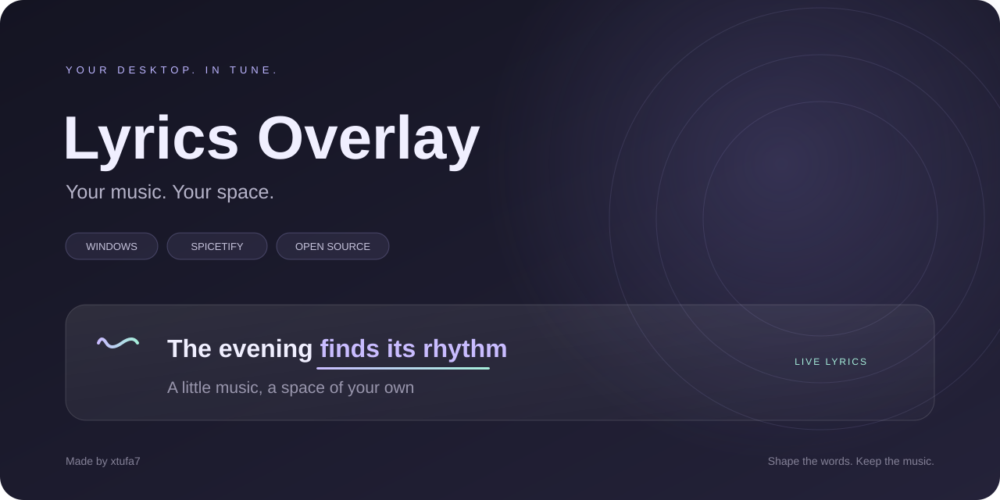
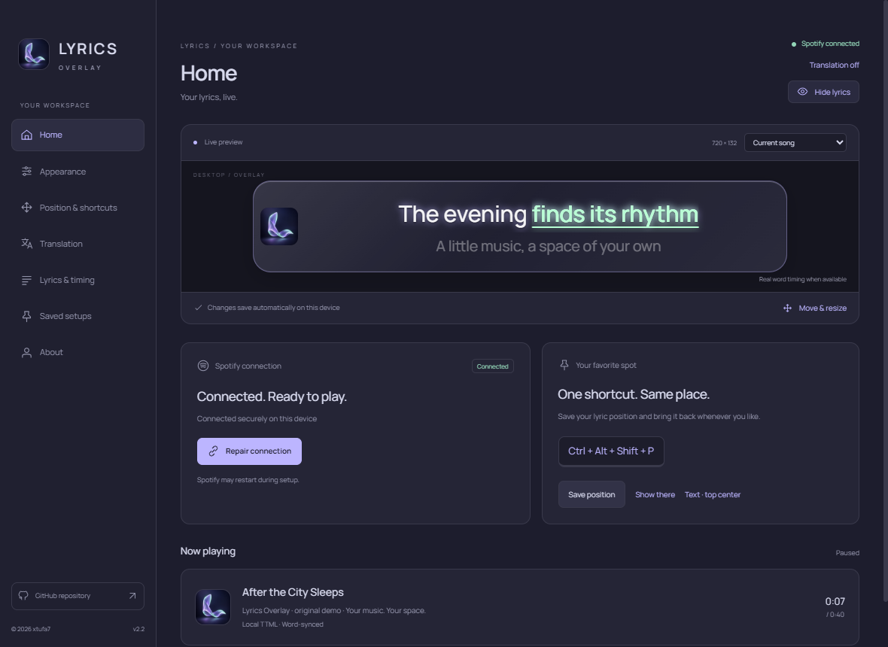
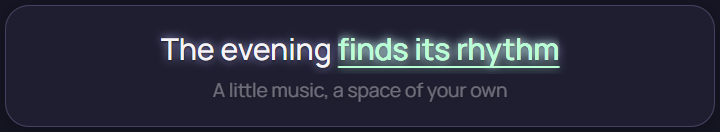
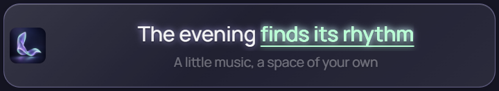
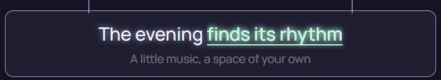
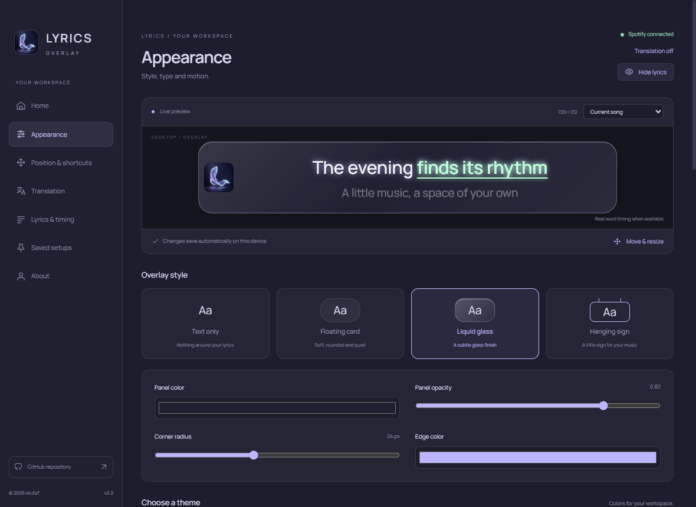

<div align="center">



[](https://github.com/xtufa7/Lyrics-Overlay/releases/latest)
[](https://github.com/xtufa7/Lyrics-Overlay/releases/latest)
[](https://github.com/xtufa7/Lyrics-Overlay/actions/workflows/build.yml)
[](LICENSE)

**Lyrics that feel at home on your desktop.**

Live words · A quieter next line · Optional translation · A look of your own

[Install](#get-started) · [Explore](#a-space-of-your-own) · [Translation](#words-without-borders) · [Help](docs/TROUBLESHOOTING.md)

</div>

## Get started

Download the **[portable ZIP or Setup EXE](https://github.com/xtufa7/Lyrics-Overlay/releases/latest)** for Windows x64. No Node.js or development tools needed. A working [Spicetify](https://spicetify.app/docs/getting-started) desktop Spotify client is required.

Or install from PowerShell:

```powershell
irm https://raw.githubusercontent.com/xtufa7/Lyrics-Overlay/main/install.ps1 | iex
```

The [installer](install.ps1) downloads the latest portable release, checks its SHA-256, creates a Start-menu shortcut and launches the companion. Files stay in versioned folders under `%LOCALAPPDATA%\0xTuFa7\LyricsOverlay`; administrator access is unnecessary.

1. Open **Lyrics Overlay** and choose **Connect Spotify**.
2. Let it apply the extension. Spotify may restart once.
3. Play a song, pick a style and make the desktop yours.

No Spotify password, login token or manual pairing code is needed. Close Settings to keep the tray app running. Use **Repair connection** after a Spotify/Spicetify reinstall.



## A space of your own

Start with nothing around the words, or give them a little home. Cover artwork is optional in every style.

| Text only | Floating card |
| :---: | :---: |
|  |  |
| **Liquid glass** | **Hanging sign** |
|  |  |

| Make it feel right | What you can change |
| --- | --- |
| **Five themes** | Midnight, Graphite, Ocean, Forest and Daylight |
| **Your typography** | Offline Manrope, Outfit, Rubik, Tajawal, Cairo, Inter and Noto Sans JP, plus Windows fonts |
| **Follow the singer** | Current-word color, sweep, moving underline, glow, pulse or bounce |
| **Between sentences** | Slide, rise, crossfade, blur, zoom or no transition |
| **Set the mood** | Text and glow colors, panel tint, opacity, border and corners |
| **A favorite place** | Top-center text shortcut, display presets, drag/resize and saved position |
| **Keep your setups** | Named complete preferences, plus export and import without API keys |
| **Find your way** | A skippable circular spotlight tour you can replay anytime |



**One shortcut. Same place.** Use **Ctrl + Alt + P** to show lyrics at your saved position, **Ctrl + Alt + L** to toggle visibility, and **Ctrl + Alt + E** to move or resize. Customize combinations in Settings; occupied defaults are replaced with available alternatives shown in the interface. Outside edit mode, clicks pass through to your applications.

Real word timestamps take priority. Line-synced songs can use **optional visual word estimates**, which may differ from the singer. Select **Exact timestamps only** to disable estimates. Long single lines can shrink to fit. Original lyric timing and shaped Arabic text stay intact.

The liquid-glass option is a styled transparent panel; native desktop blur is not guaranteed by Electron or every Windows compositor.

## Words without borders

**Arabic → English. English → Arabic. Or a language you choose.** Translation is independent: hide it instantly, move it above or below, and give it its own font, color and glow.

| Provider | Setup |
| --- | --- |
| **Auto** | Uses Gemini when a key is configured, otherwise basic MyMemory; falls back to basic translation if Gemini fails |
| **Gemini** | Your API key and a model available to your account; contextual natural, faithful or poetic translation |
| **Ollama** | Your installed local model/server; only IPv4 loopback endpoints are accepted |
| **MyMemory** | Basic keyless translation with service limits and less context |

Choose **Translate song** to request it. Merely showing translation does not send lyrics. The current sentence is prioritized, results appear as they arrive, and repeated requests can use the local cache. Gemini/MyMemory receive requested lyric text; Ollama stays local. Provider limits and billing apply. API keys are encrypted with Windows DPAPI and excluded from saved-setup exports. Translation quality depends on the provider and model.

## Small where it matters

The Spotify extension is about **4.5 KB**. The companion includes Electron's runtime, so that is not its download size or memory use. Drawing is capped at 30 fps during playback and stops while paused or hidden; hidden settings previews also stop. Fonts load locally. Playback reconnects with its existing credential, brief socket interruptions keep the current lyric, and stale track/translation responses are rejected.

## Lyrics formats

- LRC supports repeated timestamps, fractions, `[offset:]`, simultaneous lines and timed blank cues. Original line timing is preserved; optional word estimates exist only in the presentation layer.
- TTML supports parallel containers, relative `begin`/`end`/`dur`, clock/offset/frame/tick expressions with explicit rates, nested timed spans and `<br>`. An absolute-span import option supports music exports. Sequential containers, overlapping vocal paragraphs, wall-clock/drop-frame timing and XML DTD/entity declarations are explicitly rejected. This is a documented TTML subset.
- Karaoke clips a full shaped duplicate using real timed-span ranges. It does not split Arabic into disconnected glyph elements. Untimed portions remain unhighlighted.
- TXT/plain lyrics remain unsynchronized. Select a line manually in the lyrics panel.
- Complete normalized title, artist, album when available and duration within two seconds must match LRCLIB. Version words such as Live and Remix are retained. Conservative matching may miss a valid recording; importing the correct file is preferred to guessing.

Import files you are permitted to use. Provider lyrics retain their owners' rights and are not bundled or published with this project. Undocumented Spotify lyrics APIs and extraction from unrelated extensions are not used.


<details>
<summary><strong>Build it yourself</strong></summary>

Node 24 on Windows is used in CI.

```powershell
npm ci
npm run check
npm run test:desktop
npm run start
npm run dist
npm run test:packaged
```

If npm skipped Electron's download, run `node node_modules/electron/install.js` once. Builds include runtime, offline fonts and licenses. `release/` contains the installer and portable archive. Desktop checks use isolated profiles and port **43828**; production uses **43827**. Run one desktop suite at a time.

| Directory | Purpose |
| --- | --- |
| `src/extension` | Spicetify playback client |
| `src/lyrics` | Parsers, provider matching, translation |
| `src/main` | Lifecycle, local authentication, persistence |
| `src/renderer` | English settings, live preview, overlay |
| `src/shared` | Schemas, clocks, direction and attribution |

</details>

## A few useful links

[Verification](docs/VERIFICATION.md) · [Security](docs/SECURITY.md) · [Troubleshooting](docs/TROUBLESHOOTING.md) · [Contributing](CONTRIBUTING.md) · [Release notes](docs/RELEASE-NOTES.md) · [Arabic quick start](docs/START-HERE.ar.md)

Settings, caches and imported lyrics live under `%APPDATA%\Spicetify Lyrics Overlay`. Exclusive-fullscreen/protected apps may hide overlays. Releases are unsigned. Multiple physical monitor/DPI combinations and clean-VM installation remain manual QA.

---

<div align="center">


**Made by [xtufa7](https://github.com/xtufa7)** · Your music. Your space.

[Website](https://xtufa7.github.io/) · [GitHub](https://github.com/xtufa7) · [X](https://x.com/0xtufa7) · [Instagram](https://instagram.com/inoor.jpg)

© 2026 xtufa7 · [MIT](LICENSE) · Independent of Spotify and Spicetify.

Screenshots use original demo text. Lyrics, fonts and dependencies retain their respective owners' rights.

</div>
