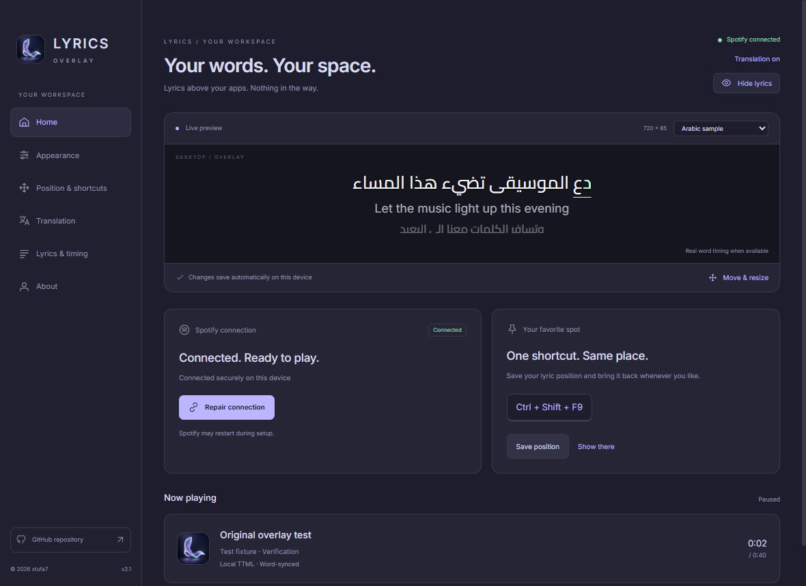

# Lyrics Overlay

**Your music. Your space.** A frameless Windows desktop lyrics overlay for Spicetify, by **[Nour Al-Shammari · 0xTuFa7](https://xtufa7.github.io)**.



Current words, a quieter upcoming sentence, optional translation and album cover above your applications. No permanent rectangle, toolbar or background. The settings interface is English; lyrics and translations retain their own language and direction. The desktop companion runs independently of Spotify and passes clicks through.

## Download

**[Get the latest Windows release](https://github.com/xtufa7/Lyrics-Overlay/releases/latest)** — choose the portable x64 ZIP or Setup EXE. No Node.js or developer tools are needed to run the companion. A configured [Spicetify](https://spicetify.app/docs/getting-started) desktop client is required.

### Install from GitHub

The installer downloads the latest portable release, verifies its SHA-256 against the release manifest, creates a Start-menu shortcut, launches the companion and connects the extension:

```powershell
irm https://raw.githubusercontent.com/xtufa7/Lyrics-Overlay/main/install.ps1 | iex
```

You can [read the script](install.ps1) first, or download/extract the ZIP yourself. The portable installer keeps versioned files under `%LOCALAPPDATA%\0xTuFa7\LyricsOverlay`. It does not require administrator access.

### Connect Spotify

1. Open Lyrics Overlay.
2. Click **Connect Spotify** on the home screen.
3. The companion installs its extension, provisions an authenticated local credential and applies Spicetify. Spotify may restart. No Spotify login, password or manual pairing code is needed.
4. Play a song. The home screen shows the actual connection, current track and lyrics source. You can minimize Spotify or close Settings while the tray app stays running.

The advanced section retains manual pairing as a fallback. **Repair / update connection** repeats setup if Spotify was reinstalled or Spicetify needs reapplying. Merely enabling an extension without starting the companion cannot draw above other Windows applications.

## Make it yours

| Feature | Behavior |
| --- | --- |
| Themes | Midnight, Graphite, Ocean, Forest and Daylight; instant previews |
| Album artwork | Spotify cover in now playing; optional cover beside desktop lyrics |
| Guided tour | First-run circular spotlights; skip or replay from About |
| Word motion | Current-word color or progressive sweep, plus an optional moving underline |
| Frameless lyrics | Transparent normal mode; legacy border/background settings are ignored |
| Upcoming sentence | Optional smaller, dimmer next cue; blanks and final cues handled correctly |
| Saved position | Save the current location, then restore it and show lyrics with one shortcut |
| Languages | First-strong Unicode direction, per-line RTL/LTR entrance, intact shaped text |
| Animation | Slide, cinematic fade, real-timed karaoke, minimal and dynamic; reduced motion |
| Appearance | Offline Cairo/Inter/Noto Sans JP, size, weight, colors, opacity, shadow and glow |
| Timing | Play/pause, seeks, track changes, monotonic interpolation and per-track/global offsets |
| Sources | Strict LRCLIB lookup/search, local LRC/TTML/TXT imports, disk cache |
| Translation | Contextual Gemini, local Ollama, or basic keyless MyMemory |

Real word timestamps always take priority. For ordinary line-synced lyrics, **Estimate when needed** distributes a visual word highlight across the line; it cannot recover the singer's exact word timing. **Exact timestamps only** turns these estimates off. Provider timestamps and lyric files are never altered. Motion presets animate line transitions independently from word highlighting.

The Spotify extension is about **4.5 KB** without a bundled desktop validation library. Overlay updates are capped at 30 fps while playing and stop when paused or hidden. Settings previews stop while hidden or on About. The companion includes Electron's runtime; the small extension size is not the total application size.

Default shortcuts are **Ctrl + Alt + L** (visibility), **Ctrl + Alt + E** (edit), and **Ctrl + Alt + P** (show at saved position). If a shortcut is already occupied, the app selects an available alternative and displays it in the position/settings UI. Click a shortcut field and press a new combination to customize it.

Use Edit Mode to drag the overlay or resize its bottom-right corner. **Done**, Escape or the edit shortcut returns to click-through mode. Placement presets, explicit coordinates and display selection are available under **Position & shortcuts**. Measurements use Windows logical pixels. A disconnected/rescaled monitor is handled by clamping bounds to an available work area.

## Translation

Translation is requested explicitly under **Translation**; enabling display alone does not send a song to a service. **Automatic · Arabic ↔ English** translates Arabic lines into English and English lines into Arabic. Select a target language to override this. The header switch instantly hides or restores translation.

Translation has its own font, size, color, glow, opacity and above/below placement. AI providers support natural, faithful and poetic styles, with separate cache identities so changing the style cannot silently reuse a different result.

- **Gemini** translates up to 30 requested lines per batch with surrounding context, track title and artist. Supply your own API key and a model available to your account. Provider limits/billing apply. Keys are encrypted using Windows DPAPI through Electron `safeStorage`; they are never sent to Spotify or returned in state snapshots.
- **Ollama** uses a model already installed on your computer (for example `qwen3:8b`). Run its local server and select the model. Only `http://127.0.0.1` endpoints are accepted; no API key is needed and lyric text stays local.
- **MyMemory** offers basic keyless translation with usage limits and lower contextual quality. Repeated lines are deduplicated; automatic source-language detection can be overridden. Long lines are rejected instead of silently truncated.

Gemini and MyMemory receive lyric text when you request translation. Translation quality depends on the service/model; results can still need human review. Every AI response must preserve requested line IDs; missing, duplicate or mismatched mappings are rejected. Translation never changes the original timing or invents word timestamps. Results cache per track text, provider, language and model.

## Lyrics formats

- LRC supports repeated timestamps, fractions, `[offset:]`, simultaneous lines and timed blank cues. Original line timing is preserved; optional word estimates exist only in the presentation layer.
- TTML supports parallel containers, relative `begin`/`end`/`dur`, clock/offset/frame/tick expressions with explicit rates, nested timed spans and `<br>`. An absolute-span import option supports music exports. Sequential containers, overlapping vocal paragraphs, wall-clock/drop-frame timing and XML DTD/entity declarations are explicitly rejected. This is a documented TTML subset.
- Karaoke clips a full shaped duplicate using real timed-span ranges. It does not split Arabic into disconnected glyph elements. Untimed portions remain unhighlighted.
- TXT/plain lyrics remain unsynchronized. Select a line manually in the lyrics panel.
- Complete normalized title, artist, album when available and duration within two seconds must match LRCLIB. Version words such as Live and Remix are retained. Conservative matching may miss a valid recording; importing the correct file is preferred to guessing.

Import files you are permitted to use. Provider lyrics retain their owners' rights and are not bundled or published with this project. Undocumented Spotify lyrics APIs and extraction from unrelated extensions are not used.

## Development

Node 24 LTS is recommended on Windows:

```powershell
npm ci
npm run check
npm run test:desktop
npm run start
npm run dist
npm run test:packaged
```

If npm's script policy skipped Electron's download, run `node node_modules/electron/install.js` once. Builds include offline fonts, runtime and licenses. `dist` contains the companion and extension; `release` contains the NSIS installer and portable ZIP. Automated desktop tests use an isolated profile and test-only port **43828**, so real Spotify's local connection on **43827** is not disturbed. Do not run multiple desktop suites simultaneously.

```
src/extension/     Documented Spicetify playback API and reconnecting client
src/shared/        Protocol schemas, monotonic clock, direction and attribution
src/lyrics/        Parsers, strict provider matching and translation adapters
src/main/          Local authentication, lifecycle, settings and minimal preload
src/renderer/      Arabic settings UI, live preview and frameless lyric rendering
scripts/          Build, deployment and packaged Electron checks
tests/            Focused engine, security, persistence and translation tests
```

Playback is event-driven with low-rate correction, revision/sequence rejection and cancellation of stale provider/translation requests. Settings, imported files, offsets and cache live under `%APPDATA%\Spicetify Lyrics Overlay`. Successful provider cache entries refresh after seven days and remain usable offline; missing results cache for fifteen minutes. The cache is pruned at startup and periodically during writes.

See [Arabic quick start](docs/START-HERE.ar.md), [verification](docs/VERIFICATION.md), [security](docs/SECURITY.md), [troubleshooting](docs/TROUBLESHOOTING.md) and [contributing](CONTRIBUTING.md). Exclusive-fullscreen/protected applications may hide overlays; no protection bypass is attempted. Releases are unsigned unless a real publisher certificate is configured. Clean-VM installation and multiple physical monitor/DPI combinations remain manual release checks.

## Developer

**Nour Al-Shammari · 0xTuFa7** — [Website](https://xtufa7.github.io/) · [GitHub](https://github.com/xtufa7) · [X](https://x.com/0xtufa7) · [Instagram](https://instagram.com/inoor.jpg) · [Email](mailto:tufa7shaml@gmail.com).

© 2026 0xTuFa7. Application code is MIT licensed. Bundled fonts retain their SIL Open Font Licenses, and other bundled dependencies retain their licenses. Independent of Spotify/Spicetify.
